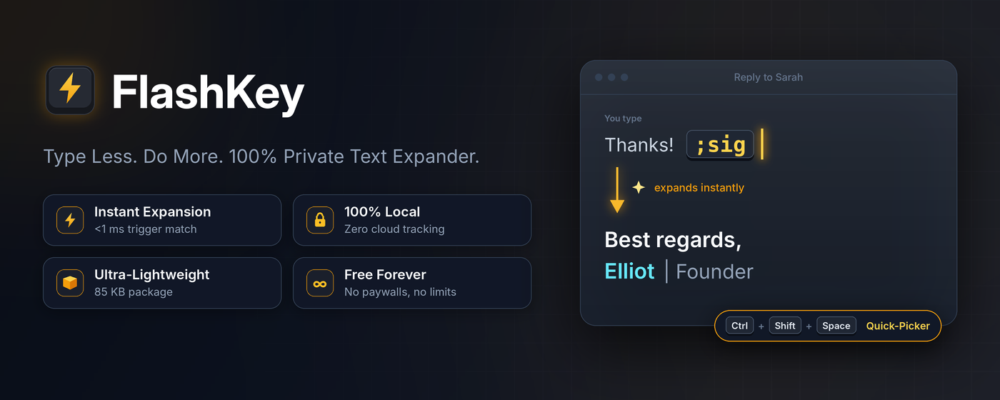
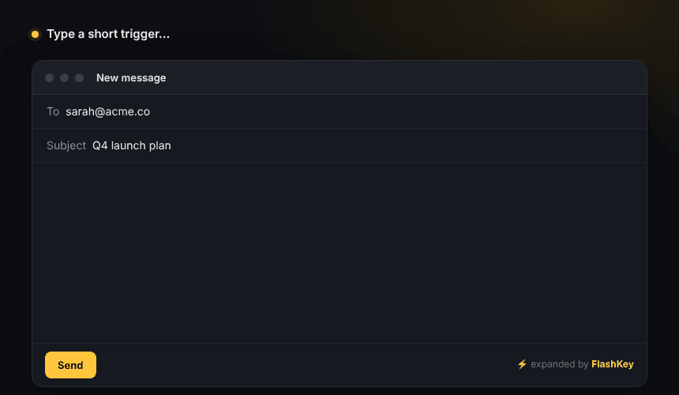
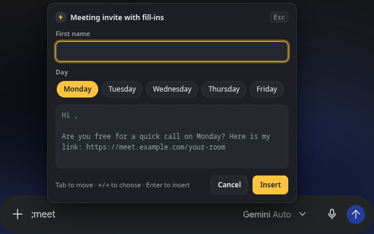
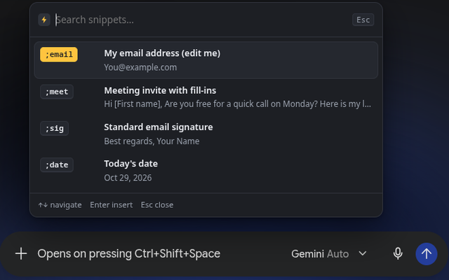
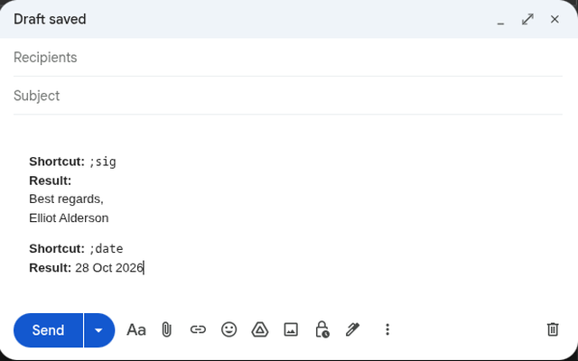
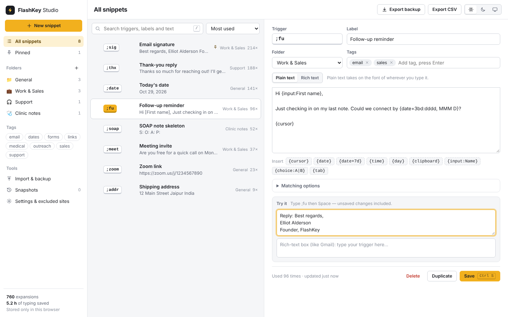
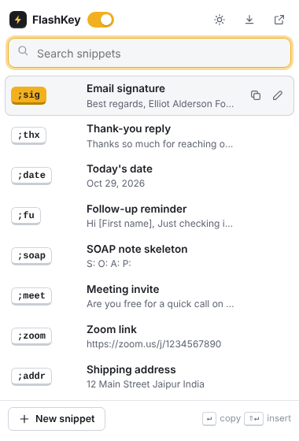
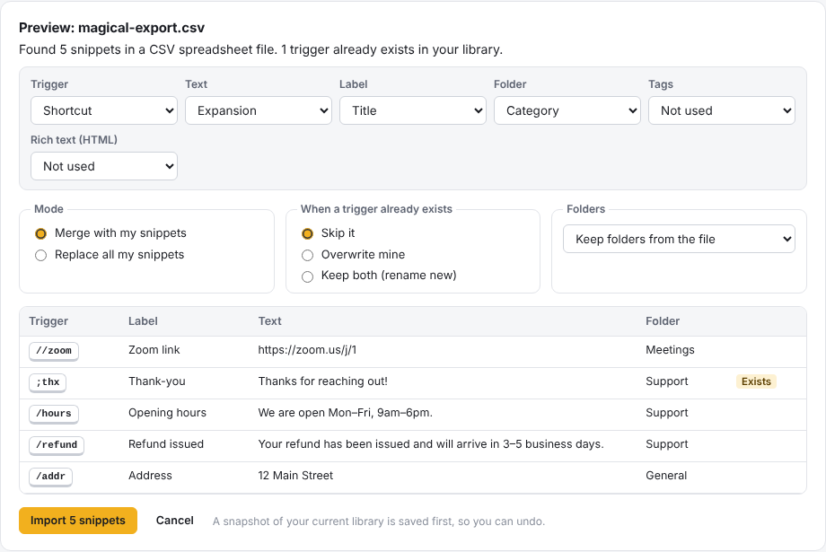
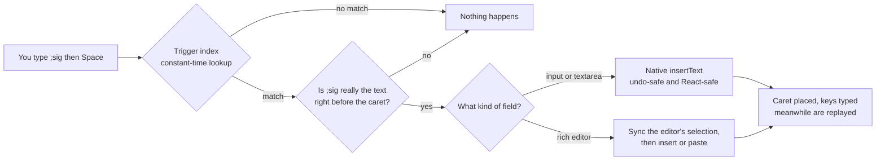

<p align="center">
  
</p>

<h3 align="center">Type a short trigger. Get the full text. Anywhere on the web.</h3>

<p align="center">
  A fast, free and fully offline text expander for Chrome, Brave, Edge and other Chromium browsers.<br>
  No account. No limits. No tracking. Your snippets never leave your computer.
</p>

<p align="center">
  <a href="https://github.com/elliotlucid090806/Flashkey/actions/workflows/ci.yml"></a>
  
  
  
  
  
  <a href="LICENSE"></a>
</p>

<p align="center">
  <a href="#install"><b>Install</b></a> ·
  <a href="#see-it-in-action">Demo</a> ·
  <a href="#features">Features</a> ·
  <a href="#dynamic-variables">Variables</a> ·
  <a href="#bring-your-snippets-with-you">Import</a> ·
  <a href="#privacy">Privacy</a> ·
  <a href="#how-it-works">How it works</a> ·
  <a href="#faq">FAQ</a> ·
  <a href="#development">Development</a>
</p>

<p align="center">
  
</p>

---

## At a glance

<table>
  <tr>
    <td width="25%" align="center"><h3>⚡</h3><b>Instant</b><br><sub>Expands in under one frame, even with 10,000 snippets</sub></td>
    <td width="25%" align="center"><h3>🔒</h3><b>Private</b><br><sub>Zero network requests. No account, no analytics</sub></td>
    <td width="25%" align="center"><h3>🪶</h3><b>Tiny</b><br><sub>85 KB, plain JavaScript, no runtime dependencies</sub></td>
    <td width="25%" align="center"><h3>♾️</h3><b>Free forever</b><br><sub>No caps, trials or paywalls. MIT licensed</sub></td>
  </tr>
</table>

## See it in action

<table>
  <tr>
    <td width="33%" valign="top">
      
      <p><b>Fill-ins.</b> <code>;meet</code> asks for a name and a day, then types the finished invite.</p>
    </td>
    <td width="33%" valign="top">
      
      <p><b>Quick-Picker.</b> Forgot a trigger? Press <kbd>Ctrl</kbd>+<kbd>Shift</kbd>+<kbd>Space</kbd> in any text box to search and insert.</p>
    </td>
    <td width="33%" valign="top">
      
      <p><b>Everyday use.</b> <code>;sig</code> and <code>;date</code> expanded inside a real Gmail compose window.</p>
    </td>
  </tr>
</table>

## Why FlashKey

| What you get | What you don't |
|---|---|
| Unlimited snippets and unlimited expansions, free | Daily caps, trials or paywalls on the basics |
| Starts working the moment it's installed | Accounts, logins or onboarding screens |
| One-click export to JSON, CSV or AutoHotKey | Your own snippets held hostage |
| Automatic safety snapshots before every bulk change | "All my snippets disappeared" |
| Expansion in under one frame, even with 10,000 snippets | Typing lag or CPU spikes |
| A quiet tool that only appears when you call it | Floating buttons or pop-ups on every page |
| Hard guardrails around passwords, one-time codes and card numbers | Interference with banking or single sign-on logins |

## Features

**Expansion that works where you type**
- Plain inputs, textareas and rich editors: Gmail, LinkedIn, Zendesk and Intercom composers, WhatsApp Web (Lexical), ChatGPT-style chat apps (ProseMirror), Quill, React and Vue forms, iframes and web components.
- Multi-line snippets go into chat apps without ever pressing Enter, so nothing gets sent early.
- <kbd>Ctrl</kbd>+<kbd>Z</kbd> brings your trigger back.
- Expand after Space, Tab, Enter or punctuation (the default), or the instant the trigger is typed.
- Caps Lock-proof, with an optional exact-case mode. Optionally expands inside words, for language and character replacements.
- Rich-text snippets with bold, italics, links and lists, strictly sanitised. Plain-text snippets take on the font of the page you're typing in.

**FlashKey Studio** — the full dashboard
- Folders, tags, pins, search and sorting (most used, A–Z, recently updated or created).
- Bulk select to move, enable, disable, export or delete.
- An editor with one-click variable buttons, duplicate-trigger warnings and a live **Try it** box that expands your unsaved draft.
- An import wizard with a preview, a column mapper, merge or replace, and skip / overwrite / keep-both for duplicates.
- Five rolling safety snapshots, each restorable in one click.
- Light, Dark and System themes, plus a per-site exclusion list with wildcards.

**Toolbar popup**
- Instant search: <kbd>Enter</kbd> copies, <kbd>Shift</kbd>+<kbd>Enter</kbd> inserts into the page.
- Quick-add a snippet in three seconds.
- Pause on the current site, switch theme, or download a backup.

**Right-click menu**
- *Save selection as FlashKey snippet*
- *Insert FlashKey snippet…*

<picture>
  <source media="(prefers-color-scheme: dark)" srcset="docs/assets/studio-dark.png">
  
</picture>

<table>
  <tr>
    <td width="36%" valign="top">
      <picture>
        <source media="(prefers-color-scheme: dark)" srcset="docs/assets/popup-dark.png">
        
      </picture>
    </td>
    <td valign="top">
      <h3>The toolbar popup</h3>
      <p>Your most-used snippets are one click away. Search by trigger, label, text or tag, then copy or insert straight into the page you're on.</p>
      <p>The switch at the top pauses FlashKey everywhere. "Pause on this site" turns it off for just the current website, and the setting is remembered.</p>
      <p>Everything shown is read from local storage. The popup makes no network requests.</p>
    </td>
  </tr>
</table>

## Dynamic variables

Put these anywhere in a snippet. Names are case-insensitive, and unknown `{tags}` are left untouched, so code snippets with braces are safe.

| Write this | You get |
|---|---|
| `{cursor}` | The caret lands here after expanding |
| `{clipboard}` | Whatever you last copied |
| `{date}` · `{date:YYYY-MM-DD}` · `{date:MMM D, YYYY}` | Today's date, in your format |
| `{date+7d}` · `{date-1d}` · `{date+1m}` · `{date+2w}` · `{date+1y}` | Date maths. Month ends are handled (Jan 31 + 1 month = Feb 28) |
| `{date+3bd:dddd}` | Three **business** days from now, e.g. *Monday* |
| `{time}` · `{time:HH:mm}` · `{time+30min}` | The current time, optionally shifted |
| `{day}` · `{day+1d}` | The weekday name |
| `{input:First name}` · `{input:City=Jaipur}` | Asks you when it expands. Repeated labels share one answer |
| `{choice:Low\|Medium\|High}` · `{choice:Day=Mon\|Tue}` | Pick one option with the arrow keys |
| `{tab}` | Jumps to the next form field and keeps filling, including drop-downs |

Date tokens follow the familiar moment.js style: `YYYY YY MMMM MMM MM M Do DD D dddd ddd HH hh mm ss A`. Wrap literal text in `[brackets]`.

<details>
<summary><b>A few snippets to start with</b></summary>

| Trigger | Snippet |
|---|---|
| `;sig` | `Best regards,`<br>`Elliot` |
| `;meet` | `Hi {input:First name}, are you free for a quick call on {choice:Day=Monday\|Tuesday\|Wednesday}?{cursor}` |
| `;due` | `Due {date+3bd:dddd, MMM D}` → *Due Tuesday, Nov 3* (on Thu, Oct 29) |
| `;ts` | `{date:YYYY-MM-DD} {time:HH:mm}` → *2026-10-29 14:05* |
| `;addr` | `Jhansi{tab}Uttar Pradesh{tab}India` → fills three form fields in one go |
| `;q` | `> {clipboard}{cursor}` → quotes whatever you copied |

</details>

## Bring your snippets with you

Import from almost anything. You always see a preview first, and a snapshot is saved automatically so any import can be undone.

| Format | Details |
|---|---|
| FlashKey backup (`.json`) | Lossless: folders, tags, settings and usage counts |
| Text Blaze, Magical, ProKeys, Auto Text Expander (`.json`) | Nested folders, key→text maps and Text Blaze form fields become FlashKey variables |
| Spreadsheets (`.csv`, `.tsv`) | Columns are detected automatically (`shortcut`, `abbreviation`, `expansion`, `category`…), with a column mapper for anything else |
| AutoHotKey (`.ahk`) | `::btw::by the way`, options such as `:*:` and `:C:`, multi-line `( … )` blocks and simple `Send` lines |

Export is always free and one click away: **JSON backup**, **CSV** that opens cleanly in Excel or Google Sheets, or **AutoHotKey hotstrings**.

<p align="center"></p>

## Privacy

FlashKey makes **zero network requests**. There's no account, no analytics, no error tracking and no server. Snippets are stored with `chrome.storage.local` on your computer, and nothing is sent to anyone.

- **Password, one-time-code, card-number and similar fields are never touched.** That covers `type=password`, `autocomplete="one-time-code"` or `cc-*`, and fields named like OTP, 2FA, CVV or SSN.
- **No `webRequest`, `cookies`, `tabs` or `scripting` permissions.** FlashKey can't read your browsing or interfere with logins.
- **Sites can be excluded entirely**, using wildcards such as `*.bank.*`, `*.okta.com` or `localhost:*`. A few banking and sign-in domains are excluded by default.
- **Clipboard access is optional.** Chrome only asks the first time you use `{clipboard}`.
- **Strict Content Security Policy** on every extension page, and on-page UI isolated in a closed Shadow DOM.
- **Developers can opt any element out** with `data-flashkey="off"`.

Read the full [privacy policy](PRIVACY.md) and the [security policy](SECURITY.md).

## How it works



- **Lazy.** Nothing loads until you focus a text field, so pages you only read, and ad iframes, cost nothing.
- **Constant-time matching.** An exact `Map` keyed by trigger, a set of possible last characters, and the distinct trigger lengths. A keystroke costs about **0.3 µs**, whether you have 10 snippets or 10,000.
- **Safe by construction.** A trigger fires only if it's both what you just typed and what sits right before the caret, so existing text in a form is never rewritten.
- **Editor-aware.** Inputs use `execCommand('insertText')`, which keeps native undo and fires real input events. Rich editors (Lexical, ProseMirror, Quill) get a moment to sync their selection, then receive the text, and multi-line text arrives as a paste so no Enter key is ever simulated.
- **Frame-aware.** It runs in every frame, including the script-built `about:blank` composers used by help-desk tools, which FlashKey re-attaches to when the page wipes its listeners.
- **Quiet.** No MutationObserver, and no scroll, touch, wheel or mouse-move listeners. The on-page UI only exists while you're using it, inside a closed Shadow DOM, so pages can't style it.

| Measured (headless Chromium) | Result |
|---|---|
| Trigger lookup, 10,000 snippets | ~0.3 µs per keystroke |
| Keystroke → expanded text on screen | ~3–6 ms (under one 16 ms frame) |
| Store package | 85 KB zipped |

## Install

**From source** (about a minute):

```bash
git clone https://github.com/elliotlucid090806/Flashkey.git
```

1. Open `chrome://extensions` (or `brave://extensions`, `edge://extensions`) and turn on **Developer mode**.
2. Click **Load unpacked** and choose the `flashkey/` folder inside the repository.
3. FlashKey Studio opens. Type `;date` then Space in any text box. That's it.

**Chrome Web Store:** coming soon.

## FAQ

<details>
<summary><b>Why does it ask for access to all websites?</b></summary>
<br>
A text expander has to notice your trigger wherever you type. FlashKey only looks at the few characters right before your cursor, in the field you're typing in, and only when you type. It never reads page content, and it makes no network requests, so nothing could leave your computer even if it did.
</details>

<details>
<summary><b>Will my snippets sync between computers?</b></summary>
<br>
Not automatically, by design. Everything stays on your computer. To move them, use <b>Export → JSON backup</b> in FlashKey Studio, then import the file on the other computer. Optional, end-to-end encrypted sync is on the roadmap.
</details>

<details>
<summary><b>A trigger doesn't expand on one website. What can I do?</b></summary>
<br>
Check that the site isn't paused (open the toolbar popup) or on your exclusion list. Password and one-time-code fields are skipped on purpose. If it still doesn't work, please <a href="https://github.com/elliotlucid090806/Flashkey/issues/new/choose">open an issue</a> with the website and the steps. A made-up example snippet is perfect.
</details>

<details>
<summary><b>How do I undo an expansion?</b></summary>
<br>
Press <kbd>Ctrl</kbd>+<kbd>Z</kbd> (<kbd>⌘</kbd>+<kbd>Z</kbd> on Mac) right after it expands. Your trigger comes back exactly as you typed it.
</details>

<details>
<summary><b>I'm moving from another text expander. Will my snippets come across?</b></summary>
<br>
Yes. Export from your current tool as JSON or CSV, then use <b>Import</b> in FlashKey Studio. You'll see a preview, choose how to handle duplicates, and a safety snapshot is saved first, so you can always undo.
</details>

## Development

The extension is plain JavaScript with **no build step and no runtime dependencies**. Node is only used for the tests and the packaging script.

```bash
npm test                          # 47 unit tests (node:test), about 1 s, nothing to install
npm install                       # dev tooling for the browser tests
npx playwright install chromium   # once
npm run test:e2e                  # 27 end-to-end tests: the real extension in headless Chromium
npm run package                   # dist/flashkey-v1.0.0.zip, validated and ready for the Web Store
npm run icons                     # regenerate the icons (stock Python, no Pillow needed)
python3 tools/make_promo_tiles.py # regenerate the store promo tiles (needs Pillow)
```

The end-to-end suite loads the unpacked extension into Chromium and types into pages built with the **real** Lexical, ProseMirror, Quill and React libraries. It also covers iframes, shadow DOM, sensitive-field guardrails, the blocklist, prompts, the Quick-Picker, the Studio import flow with snapshot undo, the popup, and a listener audit that proves no scroll, touch or mouse-move listeners are added to pages. CI runs everything on every push.

<details>
<summary><b>Project structure</b></summary>

```
flashkey/                 the extension — load this folder unpacked
├── manifest.json         MV3; storage, unlimitedStorage, contextMenus, activeTab, offscreen (+ optional clipboardRead)
├── background.js         service worker: first-run seeding, context menus, usage stats, clipboard helper
├── content.js            the expansion engine (listeners, detection, expansion pipeline, frame adoption)
├── content/
│   ├── caret.js          reads the characters before the caret (inputs and contenteditable)
│   ├── insert.js         insertion tiers: inputs/React, rich editors, {tab} field filling
│   └── overlay.js        Quick-Picker and fill-in prompt in a closed Shadow DOM
├── shared/               matcher, variables, storage (+ snapshots), formats (import/export),
│                         sanitizer, fill-in form, UI helpers, theme tokens
├── popup/                toolbar popup
├── options/              FlashKey Studio
├── offscreen/            clipboard reader for {clipboard}
└── icons/
tests/
├── unit/                 variables, matcher, formats, storage — node:test, zero dependencies
├── e2e/                  Playwright suite + harness
└── fixtures/             test pages and real-editor sources (bundled with esbuild at test time)
tools/                    icon generator, promo-tile generator, packager
store-assets/             Chrome Web Store screenshots and promo tiles
docs/assets/              images used in this README
.github/                  CI, Dependabot, issue and pull request templates
```
</details>

## Roadmap

- [ ] Chrome Web Store release
- [ ] Optional, end-to-end encrypted sync (bring your own Google Drive or GitHub Gist)
- [ ] Shared read-only team libraries for support and recruiting teams
- [ ] An optional `//` quick-search trigger as an alternative to <kbd>Ctrl</kbd>+<kbd>Shift</kbd>+<kbd>Space</kbd>
- [ ] Test fixtures for Slate and CKEditor 5
- [ ] Translations

## Contributing

Bug reports, ideas and pull requests are welcome. Please read [CONTRIBUTING.md](CONTRIBUTING.md) first. For security issues, follow [SECURITY.md](SECURITY.md) instead of opening a public issue. Release notes are in the [changelog](CHANGELOG.md).

## Author

**Elliot** · [GitHub @elliotlucid090806](https://github.com/elliotlucid090806) · legendsidleon1@gmail.com

I built FlashKey because I wanted a text expander that's fast, works everywhere I type, and never sends my words anywhere. If it saves you time, a ⭐ on the repo is the nicest way to say thanks.

## License

[MIT](LICENSE) © 2026 Elliot
